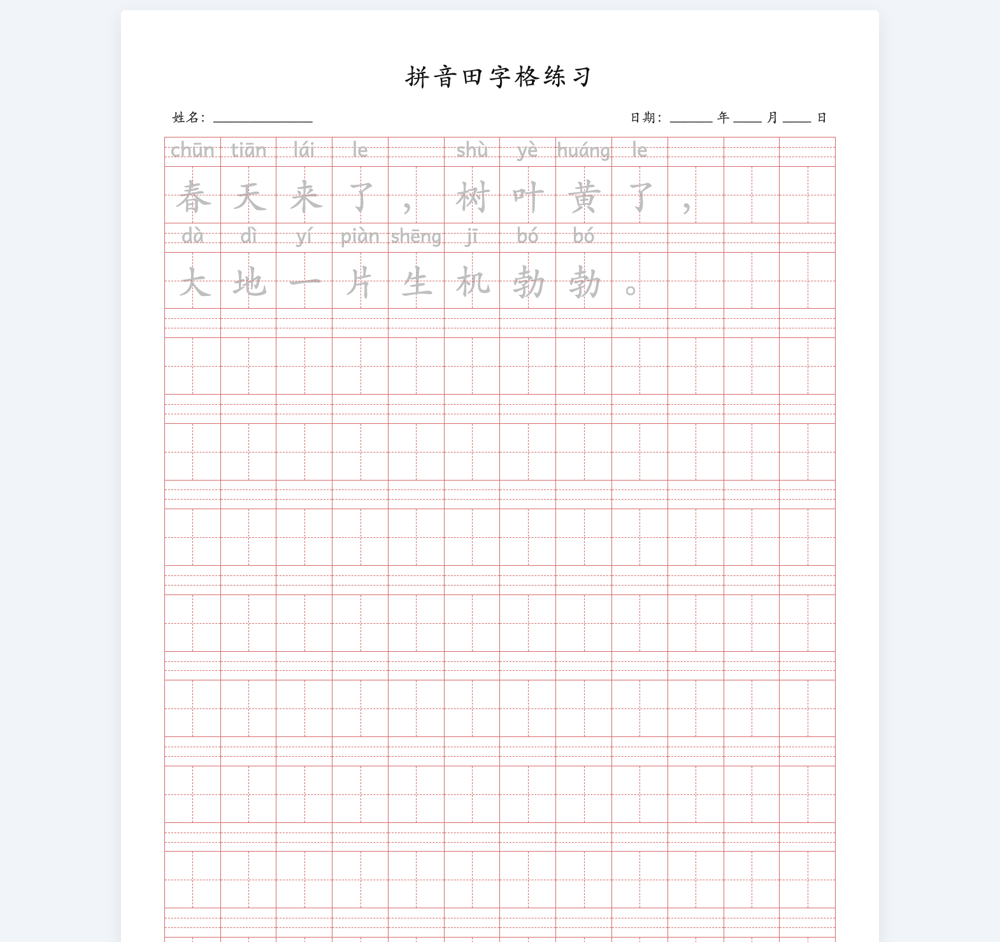
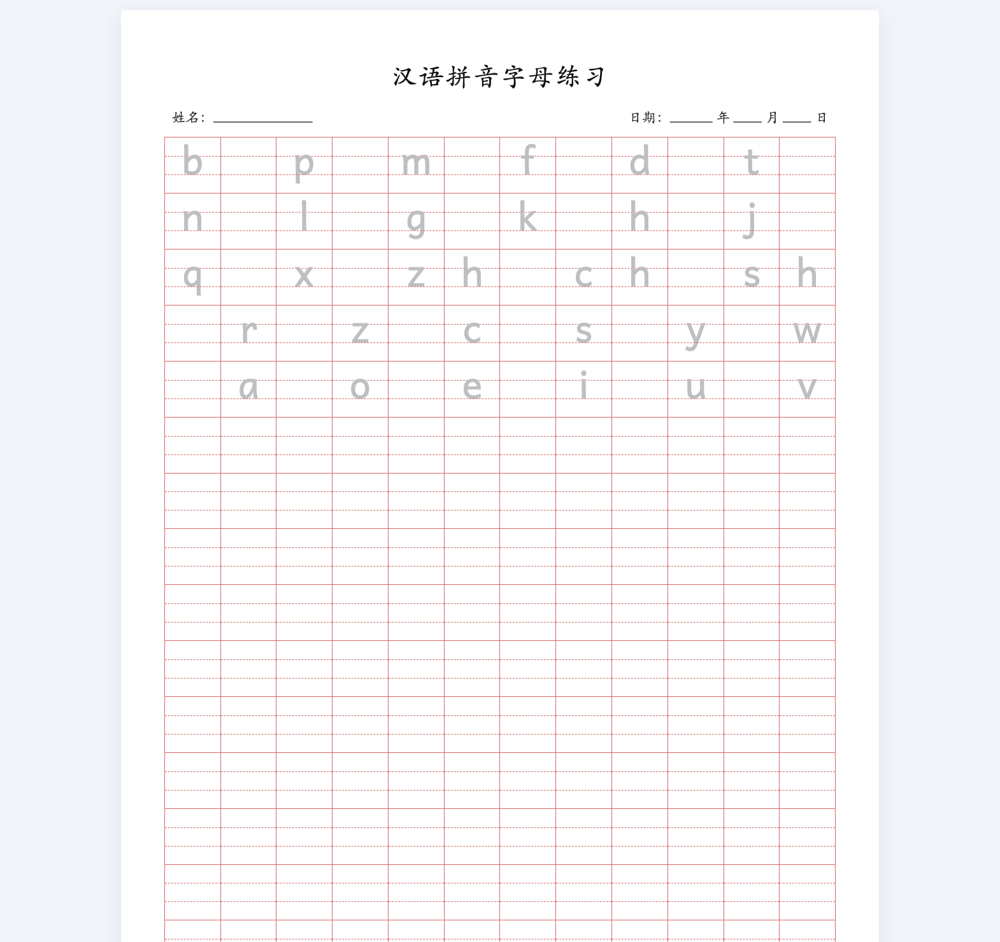
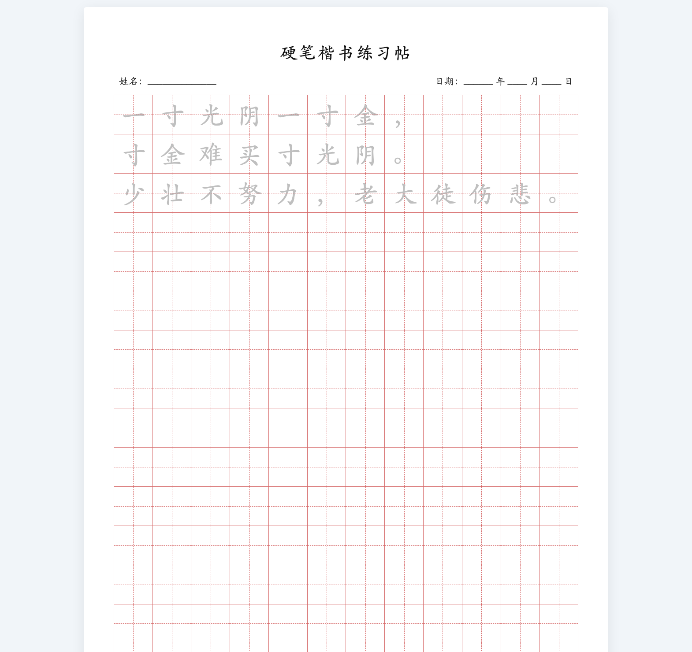
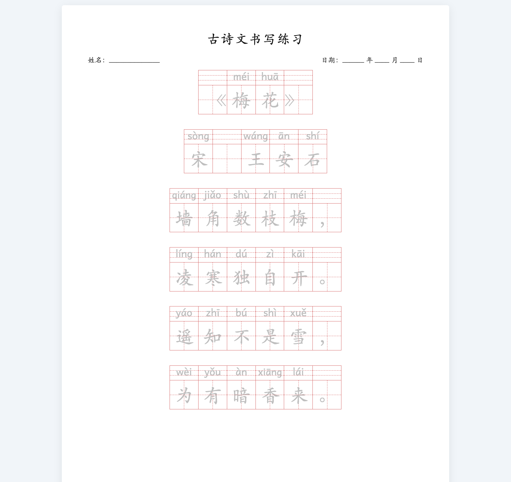

# JinZi - 拼音田字格练习纸生成器

一款轻量、开箱即用的网页端拼音田字格与字帖生成工具。纯前端单文件实现，无需安装任何构建环境或服务端依赖，支持浏览器直接预览、一键 A4 打印及「另存为 PDF」。

---

## 📸 版式预览

### 1. 拼音格 + 田字格
汉字自动智能注音，田字格练字与四线格拼音同步对照练习，支持首次描红。

### 2. 拼音格（四线三格）
专为声母、韵母、整体认读音节及英文手写字母设计，基线精准对齐第三线，高升部饱满自然。

### 3. 田字格
经典硬笔书法练字帖格式，适合整词、成语、名句临摹与书写训练。

### 4. 诗句格（五言 / 七言）
专为古诗词排版优化，按句居中对齐，标点符号与汉字统一展现完整四线三格，诗句之间舒缓留白。

---

## ✨ 核心特性

- **四种专业练字排版**：涵盖幼小衔接拼音学习、小学语文生字临摹、硬笔练字帖及古诗词排版。
- **高标准字形与网格对齐**：
  - 基于专业读写字体适配四线三格基准线。
  - 声母 `b, d, f, h, k, l` 饱满占满上格与中格，字母基线自然贴合第三线。
  - 无论汉字、标点符号还是空格，上方统一呈现规范连贯的四线三格。
  - 破折号等双格标点跨格无缝连贯连接。
- **排版与打印优化**：
  - **首行缩进与空格支持**：支持输入空格实现段落缩进（如首行缩进两格）。
  - **动态页数自适应**：根据输入的文本量自动计算所需 A4 页数，长篇文字自动换页不截断。
  - **可选标题与信息栏**：标题留空时自动隐藏并扩展正文可用行数；支持学生姓名与日期练习栏。
  - **多音字词组判定**：内置高质量汉语拼音分词与注音引擎，准确处理多音字。
  - **A4 打印优化**：精细优化打印与导出 PDF 尺寸容差，杜绝产生多余空白页。
  - **单文件便携**：内嵌所有必需样式与字体资源，离线亦可完整使用。

---

## 🚀 快速开始

### 本地使用
直接在浏览器中双击打开项目中的 `index.html` 即可开始使用。

### 导出 PDF 或打印
1. 在网页上方工具栏中输入练习内容，调整所需版式、每词重复次数及网格颜色。
2. 点击右上角 **「打印 / 导出 PDF」**（或按快捷键 `Cmd + P` / `Ctrl + P`）。
3. 在浏览器的打印预览窗口中：
   - **目标打印机**：选择真实打印机，或选择「另存为 PDF」。
   - **纸张大小**：A4。
   - **边距**：默认或无边距。
   - **背景图形**：勾选（以确保网格线条正确显示）。

---

## 📄 开源协议与第三方声明

本项目采用 **MIT License** 开源许可协议，您可以自由地使用、修改和分发本项目。

本项目在开发中引用并感谢以下优秀的开源项目与字体资源：

1. **[pinyin-pro](https://github.com/zh-lx/pinyin-pro)**
   - 用途：汉字拼音转换与多音字词组上下文分析
   - 许可协议：MIT License
   - 版权所有：Copyright (c) 2021-present, Roger

2. **[Andika 字体](https://software.sil.org/andika/)**
   - 用途：四线格拼音与英文字母高清规范显示
   - 许可协议：SIL Open Font License 1.1 (OFL-1.1)
   - 版权所有：Copyright (c) 2004-2022, SIL International
